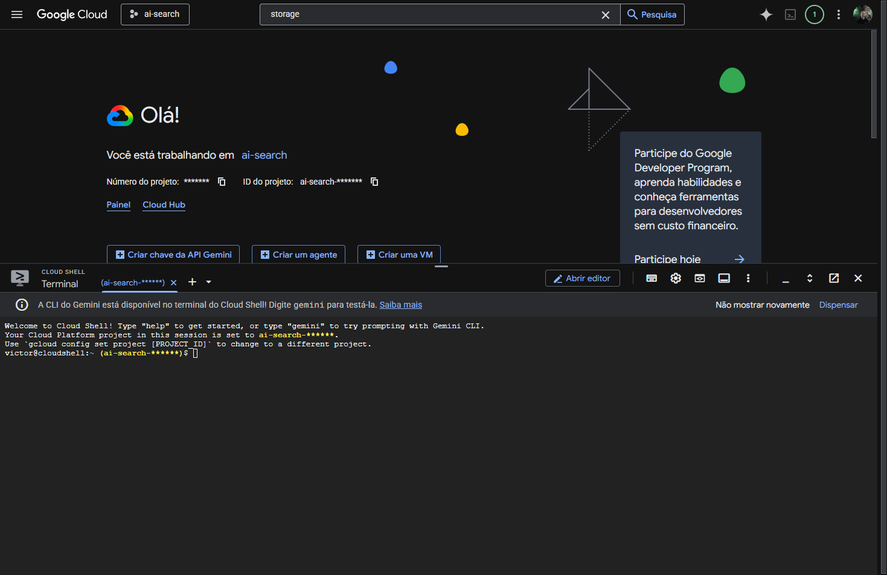
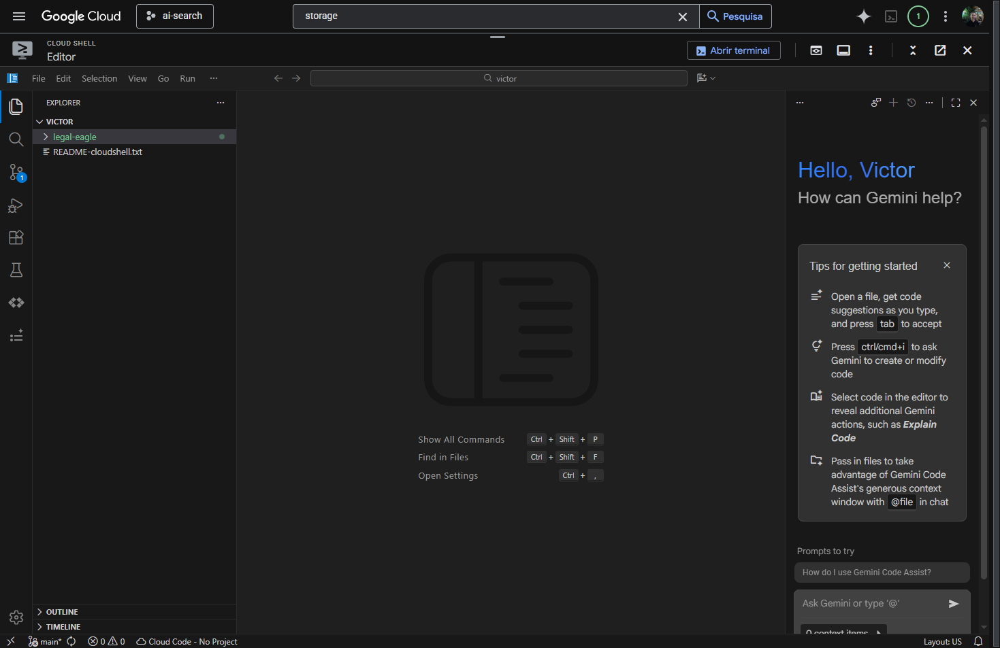
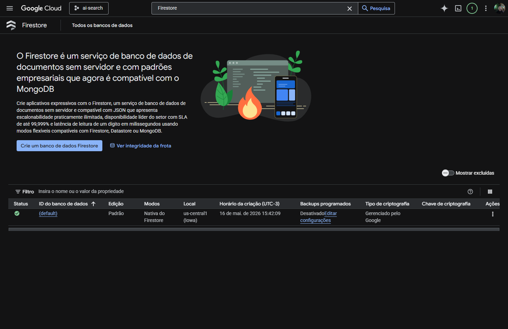
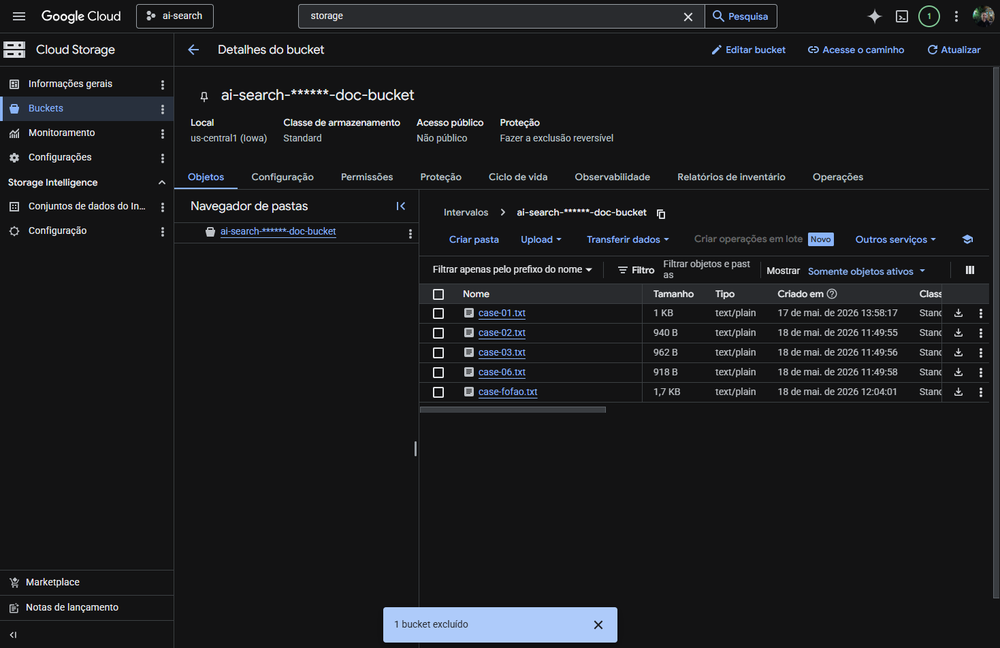
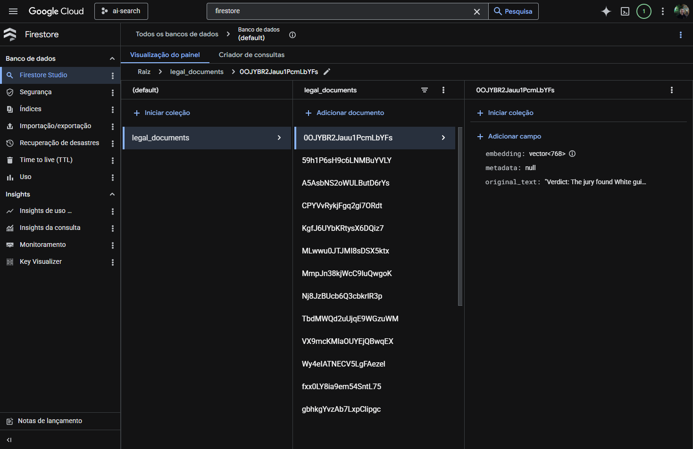
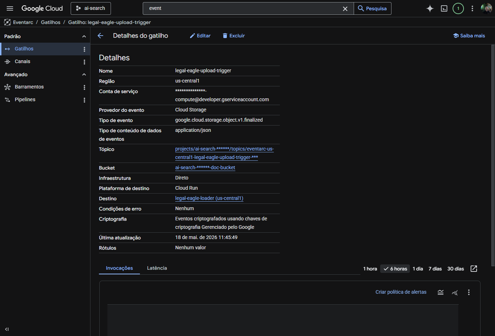
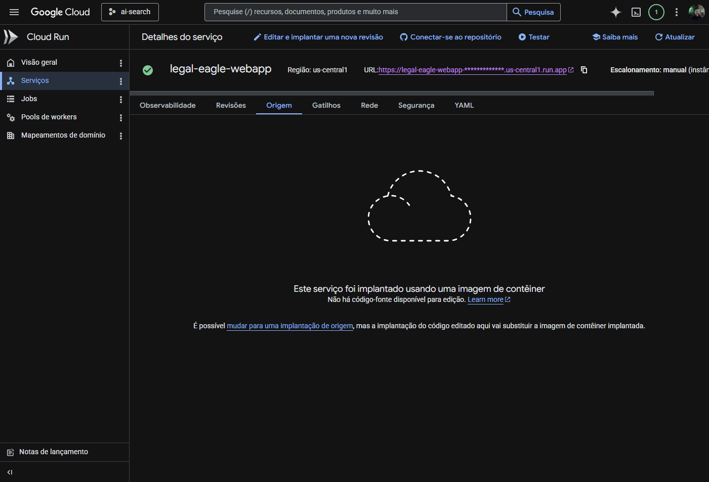
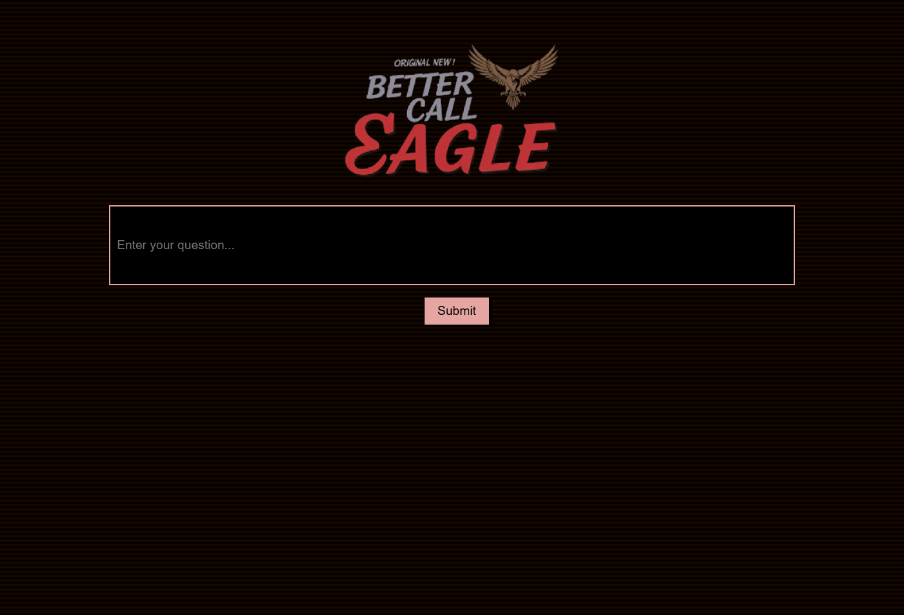

# 🦅 Legal Eagle RAG: Minha Jornada no GCP

Esse repositório não tem a proposta de ser um tutorial complexo ou extremamente técnico. É, na verdade, um relato do meu primeiro contato "mais intenso" com o Google Cloud Platform (GCP).

O Legal Eagle é uma aplicação RAG (Retrieval-Augmented Generation) focada em documentos legais, desenvolvida durante um workshop do GDG (Google Developer Groups). Tive meu primeiro contato com o projeto no GDG Americana & Caraguá no workshop do Victor Pugliese, e depois continuei o projeto com as adaptações e melhorias propostas pelo Pedro Lara.

## 🛠️ Tecnologias e Serviços Utilizados

Até então, minha experiência se resumia a Digital Ocean, Hostinger, e plataformas PaaS como Netlify e Vercel. Este laboratório me permitiu mergulhar fundo no ecossistema Google:

- Google Cloud Storage: Armazenamento bruto dos arquivos (.txt, .pdf).
- Cloud Run & Cloud Run Functions: Computação serverless para rodar a aplicação web e os scripts de processamento.
- Eventarc: Orquestração de eventos (Webhooks de gatilho).
- Firestore: Banco de dados NoSQL utilizado como nosso repositório de vetores (Vector Database).
- Vertex AI & LangChain: Inteligência Artificial e orquestração do LLM.
- Artifact Registry: Repositório de imagens Docker.

## 📑 Índice

- [O Hello World e Setup do Ambiente](#1-o-hello-world-e-setup-do-ambiente)
- [Manipulando o Código e Vertex AI](#2-manipulando-o-código-e-vertex-ai)
- [Repositório de Vetores (Firestore)](#3-repositório-de-vetores-firestore)
- [A Mágica do Loader e o Bucket](#4-a-mágica-do-loader-e-o-bucket-cloud-run-functions)
- [Docker e o Gemini Code Assist](#5-docker-e-o-gemini-code-assist)
- [Automação com Eventarc](#6-automação-com-eventarc)
- [Implementando o RAG e Deploy Final](#7-implementando-o-rag-e-deploy-final)
- [Conclusão e Sentimentos Finais](#8-conclusão-e-sentimentos-finais)

## 1. O Hello World e Setup do Ambiente

Assim que criei o projeto, acessei a tela inicial e abri o terminal do Cloud Shell. Fomos apresentados ao editor de código embutido da Google, que já vem com várias ferramentas integradas.



A primeira etapa foi configurar nossa instância. Confirmamos o login, setamos o projeto e habilitamos todas as APIs necessárias para o laboratório rodar:

```shell
# Setando o projeto
gcloud config set project <YOUR_PROJECT_ID>

# Habilitando as APIs do GCP
gcloud services enable storage.googleapis.com  \\
                        run.googleapis.com  \\
                        artifactregistry.googleapis.com  \\
                        aiplatform.googleapis.com \\
                        eventarc.googleapis.com \\
                        cloudresourcemanager.googleapis.com \\
                        firestore.googleapis.com \\
                        cloudaicompanion.googleapis.com
```

Após isso, clonamos o repositório base para começar a trabalhar.

## 2. Manipulando o Código e Vertex AI

Nessa etapa, começamos a trabalhar no código Python da aplicação. O laboratório nos incentivou a usar a IA do GCP (Gemini) como assistente para gerar a função de integração com o LLM (ask_llm).



💡 Nota de Otimização: Seguindo as dicas do Pedro Lara, passamos a utilizar o uv (um gerenciador de pacotes e projetos Python escrito em Rust, que é extremamente rápido) no lugar do pip padrão para gerenciar nossas dependências.

Testamos a aplicação localmente no terminal do Cloud Shell usando um ambiente virtual:

```shell
cd ~/legal-eagle/webapp
python -m venv .venv
source .venv/bin/activate
export PROJECT_ID=$(gcloud config get project)

# Usando o uv para instalar dependências mais rápido
uv pip install -r requirements.txt
python main.py
```

O Cloud Shell possui um recurso de "Visualizar porta", o que nos permitiu ter um preview web da aplicação rodando direto do terminal!

## 3. Repositório de Vetores (Firestore)

A função do repositório de vetores é crucial: prevenir que as respostas do LLM sejam baseadas apenas em conhecimento geral (evitando alucinações). A ideia é fornecer uma base de dados pré-estabelecida e confiável para a IA consultar antes de responder.



Como já uso o Realtime Database e o Firestore há uns 4 anos através do Firebase, essa parte foi muito familiar. A grande novidade foi criar um índice composto para permitir a pesquisa vetorial na coleção:

```shell
export PROJECT_ID=$(gcloud config get project)
gcloud firestore indexes composite create \\
--collection-group=legal_documents \\
--query-scope=COLLECTION \\
--field-config field-path=embedding,vector-config='{"dimension":"768", "flat": "{}"}' \\
--project=${PROJECT_ID}
```

## 4. A Mágica do Loader e o Bucket (Cloud Run Functions)

Para mim, essa foi a etapa mais legal e a que mais aprendi.

A ideia aqui é ter um container (Cloud Run) que fique "dormindo" para economizar recursos, e que seja acordado apenas quando um novo documento for enviado para o Bucket do Cloud Storage.

Criamos uma pasta loader e testamos a função localmente:

```shell
functions-framework --target process_file --signature-type=cloudevent --source main.py
```

### 🐛 Troubleshooting: A Batalha com o Bucket

Durante essa etapa, tive alguns problemas. Meu bucket caiu de um dia para o outro e, ao tentar recriar e rodar o script de upload, me deparei com um erro de formatação de URL (InvalidUrlError).

Descobri que o formato do comando estava incorreto. Refiz o processo listando os buckets na mão e exportando a variável corretamente:

```shell
export DOC_BUCKET_NAME=$(gcloud storage buckets list --format="value(name)" | grep doc-bucket)
```



Com o bucket online, consegui testar o evento usando o cURL para simular o upload de um arquivo:

```shell
curl -X POST -H "Content-Type: application/json" \\
     -d "{
       \\"specversion\\": \\"1.0\\",
       \\"type\\": \\"google.cloud.storage.object.v1.finalized\\",
       \\"source\\": \\"//[storage.googleapis.com/$DOC_BUCKET_NAME](https://storage.googleapis.com/$DOC_BUCKET_NAME)\\",
       \\"subject\\": \\"objects/case-01.txt\\",
       \\"data\\": {
         \\"bucket\\": \\"$DOC_BUCKET_NAME\\",
         \\"name\\": \\"case-01.txt\\"
       }
     }" http://localhost:8080/
```

Funcionou perfeitamente! O arquivo foi dividido em "chunks" (pedaços de texto), transformado em embeddings e salvo no Firestore.



## 5. Docker e o Gemini Code Assist

Chegou a hora de empacotar nossa função em uma imagem Docker para subir no Artifact Registry.

O mais interessante dessa etapa foi usar o assistente do Gemini integrado à IDE para gerar o Dockerfile. Eu sei que não é tão mágico assim e poderia apenas copiar e colar o código, mas achei uma forma legal e diferente de interagir com a ferramenta.

Aceitei a sugestão da IA e, combinando com as otimizações do Pedro Lara (usando a imagem do uv multi-stage), o nosso Dockerfile do loader ficou assim:

```dockerfile
# Use a Python 3.12 slim base image
FROM python:3.12-slim

# Adiciona o uv copiando o binário oficial (método mais rápido)
COPY --from=ghcr.io/astral-sh/uv:latest /uv /uvx /bin/

WORKDIR /app
COPY requirements.txt .

# Instala as dependências com o uv
RUN uv pip install --system --no-cache -r requirements.txt

COPY main.py .
CMD ["functions-framework", "--target", "process_file", "--port", "8080"]
```

Buildamos a imagem e fizemos o push para o GCP:

```
gcloud builds submit --tag us-central1-docker.pkg.dev/${PROJECT_ID}/legal-eagles-repository/legal-eagle-loader:latest . 
```

## 6. Automação com Eventarc

Aqui configuramos o "Gatilho" (Trigger). O Eventarc é um serviço que fica "observando" o nosso Bucket. Toda vez que um documento legal (.txt) for feito upload, o trigger dispara nossa imagem recém-criada no Cloud Run para processar o arquivo. Tudo de forma automática.



Subi alguns arquivos manualmente para testar (case-02.txt, case-fofao.txt, etc) e, ao analisar os logs do Cloud Run, foi possível ver a esteira funcionando e os dados brotando lá no Firestore!

## 7. Implementando o RAG e Deploy Final

Com o banco populado de conhecimento, voltamos para nossa Webapp para implementar o LangChain. O LangChain simplifica o fluxo de:

- Pegar a pergunta do usuário.
- Buscar o contexto semelhante no Firestore (Similarity Search).
- Entregar a pergunta + o contexto para o Vertex AI (Gemini) formular a resposta.

```python
# Trecho da integração LangChain no legal.py
def search_resource(query):
    results = vector_store.similarity_search(query, k=5)
    combined_results = "\\n".join([result.page_content for result in results])
    return combined_results
```

Por fim, empacotamos o Frontend (webapp) no Docker e rodamos o comando mágico de deploy:

```shell
gcloud run deploy legal-eagle-webapp \\
  --image us-central1-docker.pkg.dev/$PROJECT_ID/legal-eagles-repository/legal-eagle-webapp \\
  --region us-central1 \\
  --set-env-vars=GOOGLE_CLOUD_PROJECT=${PROJECT_ID}  \\
  --allow-unauthenticated
```



Resultado: Aplicação online, responsiva e consultando nossa base de dados privada!



## 8. Conclusão e Sentimentos Finais

Foi muito legal mexer de forma mais profunda com alguma Cloud de grande porte. A experiência foi incrível e pude aprender muito sobre conceitos que antes pareciam distantes:

- Webhooks & Eventarc
- Cloud Run & Serverless
- Cloud Storage & Firestore
- Vertex AI & LangChain (O coração do RAG!)
- Docker & Artifact Registry

Gostei muito de ver tudo isso se conectando, como peças de Lego. Estou ansioso para mexer ainda mais com o ecossistema do Google Cloud Platform nos meus próximos projetos!

# Autor 👨‍💻
- Todo processo de desenvolvimento do .md e relatos, [Victor Lis Bronzo](https://www.linkedin.com/in/victor-lis-bronzo)
- Formatação do .md, [Gemini](https://gemini.google.com/)