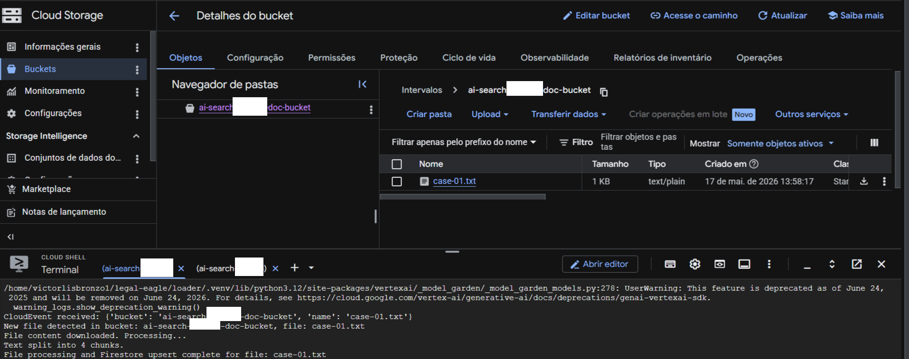
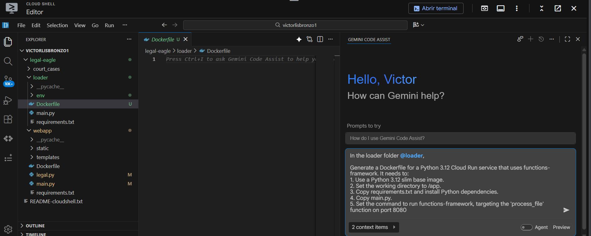
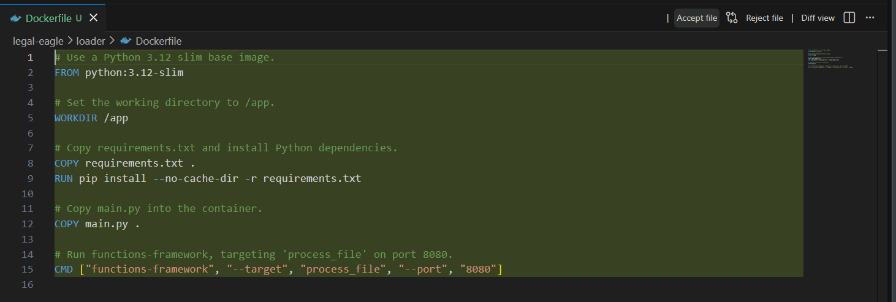

# Etapa 9

Quando cheguei na etapa 9, na hora de criar a variável de ambiente que apontava pro bucket tive errinhos pois meu bucket não estava de pé.

Ontem, na etapa de baixar as dependecias da etapa 9 acabou demorando bastante e eu não consegui continuar o projeto, mas hoje ao retoma-lo vi que o bucket não estava mais de pé (não sei bem o porque).

Enfim, criei novamente o bucket com o comando: `gcloud storage buckets create gs://PROJETO_doc_bucket --location=us-central1`, e tentei seguir para:

```bash
export DOC_BUCKET_NAME=$(gcloud storage buckets list --format="value(name)" | grep doc-bucket)
gsutil cp ~/legal-eagle/court_cases/case-01.txt gs://$DOC_BUCKET_NAME/
```

Onde ocorreu o erro:

```text
export DOC_BUCKET_NAME=$(gcloud storage buckets list --format="value(name)" | grep doc-bucket)
gsutil cp ~/legal-eagle/court_cases/case-01.txt gs://$DOC_BUCKET_NAME/
Google recommends using Gcloud storage CLI (https://docs.cloud.google.com/storage/docs/discover-object-storage-gcloud) instead of gsutil. Please refer to migration guide (https://docs.cloud.google.com/storage/docs/gsutil-transition-to-gcloud) for assistance.
InvalidUrlError: Cloud URL scheme should be followed by colon and two slashes: "://". Found: "gs:///".
```

Ai tentei fazer na mão um: `gcloud storage buckets list --format="value(name)"`, retornando o nome do(s) buckets, copiei na mão e rodei um `export DOC_BUCKET_NAME="nome-do-bucket"`

Ai deu certo.

Mas ai parti para a etapa do curl e tive um erro:

```bash
(.venv) victorlisbronzo1@cloudshell:~/legal-eagle/loader (ai-search-496518)$ functions-framework --target process_file --signature-type=cloudevent --source main.py
/home/victorlisbronzo1/legal-eagle/loader/.venv/lib/python3.12/site-packages/google/cloud/aiplatform/models.py:52: FutureWarning: Support for google-cloud-storage < 3.0.0 will be removed in a future version of google-cloud-aiplatform. Please upgrade to google-cloud-storage >= 3.0.0.
  from google.cloud.aiplatform.utils import gcs_utils
/home/victorlisbronzo1/legal-eagle/loader/.venv/lib/python3.12/site-packages/vertexai/_model_garden/_model_garden_models.py:278: UserWarning: This feature is deprecated as of June 24, 2025 and will be removed on June 24, 2026. For details, see https://cloud.google.com/vertex-ai/generative-ai/docs/deprecations/genai-vertexai-sdk.
  warning_logs.show_deprecation_warning()
CloudEvent received: {'bucket': 'ai-search-496518_doc_bucket', 'name': 'case-01.txt'}
New file detected in bucket: ai-search-496518_doc_bucket, file: case-01.txt
Error processing file case-01.txt: 404 GET https://storage.googleapis.com/download/storage/v1/b/ai-search-496518_doc_bucket/o/case-01.txt?alt=media: No such object: ai-search-496518_doc_bucket/case-01.txt: ('Request failed with status code', 404, 'Expected one of', <HTTPStatus.OK: 200>, <HTTPStatus.PARTIAL_CONTENT: 206>)
```

Ai eu percebi que tinha criado um bucket com o comando que não seguia o tutorial do codelabs, apaguei ele e recriei seguindo as etapas lá do [codelabs](https://codelabs.developers.google.com/legal-eagle-rag/instructions?hl=pt-br#6)

Ai voltei e executei o comando: `export DOC_BUCKET_NAME=$(gcloud storage buckets list --format="value(name)" | grep doc-bucket)` e agora deu certo.

Consegui enfim testar o CURL com:

```bash
curl -X POST -H "Content-Type: application/json" \
     -d "{
       \"specversion\": \"1.0\",
       \"type\": \"google.cloud.storage.object.v1.finalized\",
       \"source\": \"//storage.googleapis.com/$DOC_BUCKET_NAME\",
       \"subject\": \"objects/case-01.txt\",
       \"id\": \"my-event-id\",
       \"time\": \"2024-01-01T12:00:00Z\",
       \"data\": {
         \"bucket\": \"$DOC_BUCKET_NAME\",
         \"name\": \"case-01.txt\"
       }
     }" http://localhost:8080/
```

E consegui uma arquivo de case01.txt dentro do bucket.



Inclusive fiquei curioso sobre o uso do Firebase Storage x Google Cloud Storage, qual é melhor?

# Etapa 10

Na etapa 10, achei legal o fato de ensinar a usar o assistente do gemini para gerar o Dockerfile:



Eu sei que, não é tão mágico assim, mas achei uma forma legal / diferente de fazer, ao invés de só copiar e colar.

Então aceitei a sugestão:



Nessa etapa, acabei ficando preso em um loop de dificuldade de subir o container do docker
